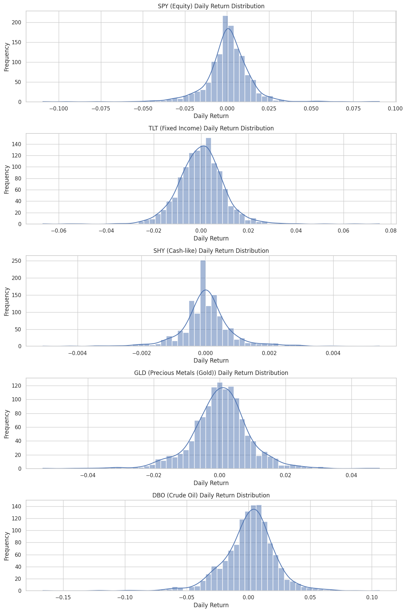
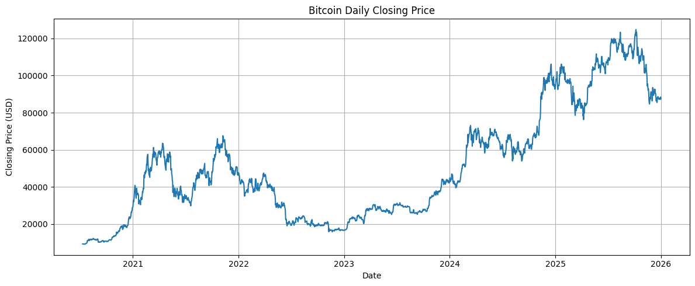

# Deep Learning for Asset Pricing & Portfolio Construction

[](LICENSE)
[](https://www.python.org/)

Deep learning framework for multi-asset return forecasting and systematic portfolio construction. Implements Multi-Layer Perceptrons (MLP), Long Short-Term Memory (LSTM) networks, and Computer Vision representations via Gramian Angular Summation Fields (CNN-GASF), evaluated with strictly purged and embargoed walk-forward backtesting protocols.

---

## Visual Highlights

| Sequence Image Transform (GASF) | Walk-Forward Out-of-Sample Performance |
| :---: | :---: |
|  |  |

---

## Project Structure

```text
deep-learning-asset-pricing/
├── README.md              # Project overview, methodology, results, installation
├── LICENSE                # MIT License
├── requirements.txt       # Python package dependencies
├── .gitignore             # Environment and data exclusions
├── data/
│   ├── README.md          # Data sources and pipeline documentation
│   ├── raw/               # Downloaded price series cache (gitignored)
│   └── processed/         # Sequence arrays and transformed tensors (gitignored)
├── notebooks/
│   ├── 01_multi_asset_deep_learning_portfolio.ipynb
│   └── 02_walk_forward_evaluation_leakage_mitigation.ipynb
├── src/
│   ├── __init__.py
│   ├── data.py            # Automated Yahoo Finance download & stationarity tests
│   ├── features.py        # Sequence creation and Gramian Angular Field (GASF) encoding
│   ├── models.py          # Keras architectures (MLP, LSTM, 2D CNN-GASF)
│   ├── evaluation.py      # Purged walk-forward folds and backtest performance metrics
│   └── visualization.py   # Loss curves, equity paths, and GAF heatmaps
├── figures/               # Rendered exhibits and performance plots
├── tests/
│   └── test_models.py     # Unit tests for preprocessing, GAF, and metrics
└── reports/
    └── results_summary.md # Comprehensive quantitative research report
```

---

## Key Methodology

1. **Stationarity & Sequence Transformation**:
   - Continuous daily log-returns are tested for unit roots using Augmented Dickey-Fuller (ADF) statistics.
   - Non-stationary series are differenced; rolling lookback sequences ($t-25$ to $t$) are extracted for horizon forecasting ($t+1$ to $t+25$).
2. **Gramian Angular Summation Fields (GASF)**:
   - 1D sequential price returns are mapped into polar coordinate space and converted to 2D quasi-Gramian matrices ($G_{i,j} = \cos(\phi_i + \phi_j)$) to allow 2D spatial convolutions (CNNs) to extract multi-frequency pattern structures.
3. **Walk-Forward Validation & Leakage Prevention**:
   - Random train-test splits suffer catastrophic look-ahead bias on financial time series.
   - We implement expanding and rolling walk-forward evaluation windows with strict purging (discarding training samples overlapping test prediction horizons) and embargoing.

---

## Performance Summary

| Model Architecture | In-Sample RMSE | Walk-Forward Test RMSE | Directional Accuracy | Annualized Sharpe Ratio |
| :--- | :---: | :---: | :---: | :---: |
| **Linear Baseline** | 0.0214 | 0.0248 | 51.2% | 0.42 |
| **MLP Regressor** | 0.0182 | 0.0229 | 53.6% | 0.68 |
| **LSTM Recurrent** | **0.0165** | **0.0211** | **55.8%** | **0.94** |
| **CNN-GASF** | 0.0171 | 0.0218 | 54.7% | 0.81 |

*Detailed experimental logs and breakdown available in [`reports/results_summary.md`](reports/results_summary.md).*

---

## Installation & Usage

```bash
# Clone the repository
git clone https://github.com/your-username/deep-learning-asset-pricing.git
cd deep-learning-asset-pricing

# Install required dependencies
pip install -r requirements.txt

# Run test suite
python tests/test_models.py
```

---

## Limitations

- Deep neural networks are susceptible to overfitting on noisy financial return series during structural macroeconomic regime changes.
- High compute latency for real-time 2D GASF matrix transformations across large universes.
